# roomdisplay: 연구실 e-paper 문패

연구실 철문 바깥에 자석으로 붙여 두는 4.2인치 3색 e-paper 문패입니다. 웹에서 그림을 누르거나, 캘린더·CCTV 자동화가 상태를 바꾸면 몇 초 안에 문패가 새 그림으로 바뀝니다. 배터리(LiPo)로 동작하고, 가끔 USB-C로 충전합니다.

<p align="center">
  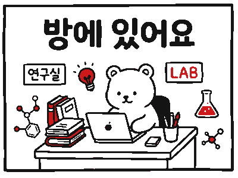
  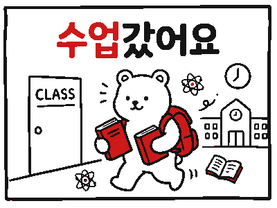
  
</p>

<p align="center">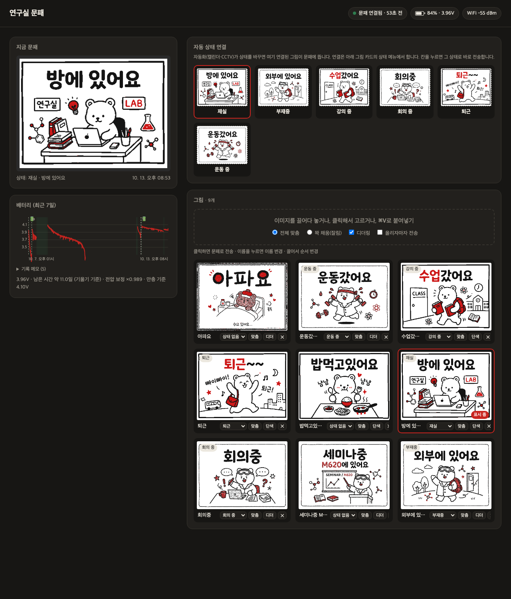</p>

## 구성

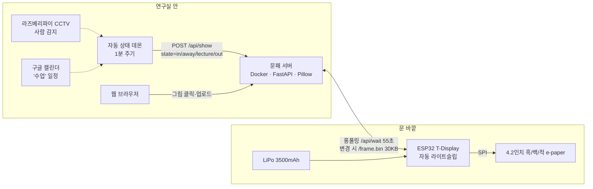

- **서버가 그림을 그립니다.** 업로드한 이미지나 상태 화면을 400×300 흑/백/적 3색으로 변환(디더링)합니다. 그런 다음 흑 평면과 적 평면을 각각 1비트로 담은 30KB 비트맵을 만듭니다. 한글 폰트도 서버에서 처리하므로 ESP32에는 폰트가 필요 없습니다.
- **ESP32는 기다리기만 합니다.** `/api/wait?seq=N`으로 롱폴링하다가 서버의 상태 번호(seq)가 바뀌면 `/frame.bin`을 받아 전체 갱신합니다. 3색 패널이라 갱신에 약 11초가 걸립니다. 그 밖의 시간에는 WiFi 연결을 유지한 채 자동 라이트슬립으로 대기합니다. 웹에서 클릭하면 0.3초 안에 반응합니다.
- **상태는 그림으로 표시합니다.** 재실, 부재중, 강의 중, 회의 중, 퇴근, 운동 중 같은 상태마다 그림을 하나씩 연결해 둡니다. 자동화는 상태 이름만 보내고, 서버가 연결된 그림으로 바꿔 표시합니다. 보여 줄 그림이 지금과 같으면 문패를 다시 그리지 않습니다(e-paper 마모와 배터리 절약).

## 폴더

| 경로 | 내용 |
|---|---|
| [`server/`](server) | 문패 서버(FastAPI + Pillow, Docker). 웹 UI는 `server/app/static/index.html` |
| [`firmware/`](firmware) | ESP32 펌웨어(PlatformIO). 기본 env `tdisplay_lp` = arduino + ESP-IDF, 자동 라이트슬립 |
| [`hardware/`](hardware) | **부품 목록, 결선, 3D 프린터 케이스(SCAD/STL)**, e-paper 동작 확인 스케치 |
| [`docs/`](docs) | 전력·배터리 기록, 그림, 원시 배터리 로그, 초기 설계 문서 |

## 웹 UI

- **자동 상태 연결**: 상태마다 연결된 그림이 보입니다. 칸을 누르면 그 상태로 바로 전송됩니다.
- **그림**:
  - 이미지를 끌어다 놓거나, 파일을 고르거나, ⌘V로 붙여넣어 올립니다.
  - 카드를 누르면 문패로 전송됩니다.
  - 카드마다 상태 연결, 이름 변경, 맞춤/채움, 디더링 켜기·끄기, 삭제가 있습니다.
  - 끌어서 순서를 바꿉니다.
- **배터리**:
  - 잔량과 전압, 충전 중이면 충전 진행률(추정)이 표시됩니다.
  - 남은 시간은 "잔량 × 지난 완충 1회 지속 시간"으로 계산합니다.
  - 그래프에는 7일치 기록이 표시되고, 배터리 교체·펌웨어·보정 같은 이벤트가 세로선으로 표시됩니다.
  - '기록 메모'에서 이벤트를 직접 추가할 수 있습니다.
- 브라우저 탭이 보일 때만 상태는 20초, 기기 정보는 60초마다 조회합니다. 웹 조회는 서버에만 가고 문패 기기와는 통신하지 않습니다.

AI 이미지 생성 도구(예: nanobanana)로 만든 그림을 스크립트에서 바로 올릴 수도 있습니다.

```bash
curl -F file=@image.png -F show=true -F dither=false http://<server>:8070/api/images
```

## API

| 메서드 | 경로 | 설명 |
|---|---|---|
| GET | `/api/state` | 현재 표시 대상과 seq |
| POST | `/api/show` | `{"kind":"status","state":"in"}` 또는 `{"kind":"image","id":"…"}`. 응답의 `refreshed`가 false면 같은 그림이라 문패를 다시 그리지 않음 |
| GET | `/api/statuses` | 상태 목록과 각 상태에 연결된 그림 |
| GET/POST | `/api/images` | 그림 목록, 업로드(`file`, `fit=contain\|cover`, `dither`, `show`) |
| POST | `/api/images/{id}/meta` | `{"name":"…","state":"in"}`. 이름 변경, 상태 연결(`""`이면 해제) |
| POST | `/api/images/{id}/reconvert` | 맞춤/채움, 디더링 다시 변환 |
| GET | `/api/pool`, POST `/api/pool/order` | 그림 순서 |
| GET | `/api/device` | 배터리, RSSI, 충전 추정, 남은 시간, 7일 기록, 펌웨어 진단값 |
| GET/POST | `/api/events` | 배터리 교체·펌웨어·보정·메모 기록 |
| GET | `/api/wait?seq=&w=&bat=&rssi=&up=&rr=&nf=&ds=` | ESP32 롱폴링 + 상태 보고 |
| GET | `/frame.bin` | ESP32용 비트맵. 흑 평면 15000B + 적 평면 15000B(MSB 우선, 1 = 잉크) |
| GET | `/api/current.png`, `/api/images/{id}/preview.png` | 미리보기 |

상태 키는 `in`(재실), `away`(부재중), `lecture`(강의 중), `meeting`(회의 중), `out`(퇴근), `exercise`(운동 중)입니다. 키를 추가하려면 [`server/app/render.py`](server/app/render.py)의 `STATES`에 넣습니다.

## 설치

### 서버

```bash
cd server
echo 'ROOM_TITLE=○○○ 교수 연구실' > .env     # 그림이 연결되지 않은 상태의 글자 화면 제목
docker compose up -d --build                  # http://<server>:8070
```

데이터(그림, 상태, 배터리 기록, 보정값)는 `server/data/`에 쌓입니다. 배터리 관련 기본값은 `compose.yaml`의 `BAT_MAH`, `CHARGE_MA`로 정합니다.

### 펌웨어

```bash
cd firmware
cp include/secrets.example.h include/secrets.h   # SSID, 비밀번호, 서버 주소 입력
~/.platformio/penv/bin/pio run -e tdisplay_lp -t upload
```

- `platformio.ini`의 `upload_port`를 자기 환경에 맞게 바꿉니다.
- 첫 빌드는 ESP-IDF를 받아 오느라 몇 분 걸립니다.
- 라이트슬립 중에는 Arduino `Serial`이 깨지므로 로그는 `printf`(IDF 콘솔)로만 출력합니다.

### 자동 상태 전환 (선택)

이 저장소에는 자동화 코드를 넣지 않았습니다. 실제 운용에서는 별도의 데몬이 1분마다 다음처럼 판단해 `POST /api/show {"kind":"status","state":…}`를 보냅니다.

- **구글 캘린더**: '수업' 캘린더 일정이 진행 중이면 `lecture`
- **라즈베리파이 CCTV(Frigate)의 사람 감지**:
  - 최근 15분 안에 감지되면 `in`
  - 150분 안이면 `away`
  - 저녁 이후 감지가 끊기면 `out`
- **수동 우선**: 웹에서 직접 바꾸면 30분 동안 자동 전환을 멈춥니다.

서버는 같은 그림이면 다시 그리지 않으므로, 자동화가 같은 상태를 반복해 보내도 괜찮습니다.

## 운용하며 배운 것

자세한 기록은 [docs/power-and-battery.md](docs/power-and-battery.md)에 있습니다.

| 문제 | 원인과 해결 |
|---|---|
| 배터리 3시간 만에 방전 | Arduino 기본 빌드에는 `CONFIG_PM_ENABLE`이 없어 라이트슬립이 불가능함 → arduino + ESP-IDF 하이브리드 빌드로 자동 라이트슬립 적용. **방전 속도 약 13배 개선** |
| 라이트슬립 중 시리얼 로그 깨짐 | CPU 주파수 변경(DFS)으로 Arduino `Serial`의 보율이 틀어짐 → IDF 콘솔(`printf`, REF_TICK 클록)로만 로그 출력 |
| 롱폴링이 63초마다 끊김 | `HTTPClient::setTimeout()` 인자가 `uint16_t`(ms)라서 260000이 63392로 잘림 → 대기 55초, 타임아웃 65초로 변경 |
| WiFi 접속 실패(reason 201) | SSID 대소문자 불일치 |
| 완충했는데 93%로 표시 | 이 보드의 충전 회로는 약 4.10V에서 충전을 끝내고, ADC는 약 1% 높게 읽음 → 멀티미터 기준 전압 보정과 '실제 만충 전압 = 100%' 보정을 따로 둠 |
| 배터리가 꺼진 뒤 문패가 마지막 상태를 계속 표시 | 잔량 8% 이하이면 빨간 '배터리 부족' 띠를 덧그려서, 꺼진 뒤에도 경고가 화면에 남게 함 |
| 철문 밖에서 WiFi 불안정 | 철판이 보드 안테나를 가림(-75~-85dBm) → 연속 실패 시 WiFi 재연결, 20분 무응답 시 재부팅하는 자가 복구. 공유기 위치 개선이나 안테나를 철판에서 띄우는 방법은 [hardware](hardware) 참고 |

## 앞으로

- 새 3500mAh 셀로 완충부터 방전까지 1회 지속 시간을 측정해 기준값을 확보(기존 셀은 41시간)
- 3–4주에 못 미치면 ESP32-C6(예: FireBeetle 2 ESP32-C6)로 바꾸고 Wi-Fi 6 TWT(Target Wake Time) 적용
- 케이스 개정: 현재 결선(윗줄 헤더), 큰 배터리 무게 고정, 안테나를 철판에서 띄우는 구조

## 그림

문패용 곰 일러스트는 AI 이미지 생성 도구로 만들었습니다. 원본은 [`docs/images/illustrations`](docs/images/illustrations), 3색 변환본은 [`docs/images/epaper`](docs/images/epaper)에 있습니다.

| 방에 있어요 | 외부에 있어요 | 수업갔어요 | 회의중 | 퇴근 |
|---|---|---|---|---|
| 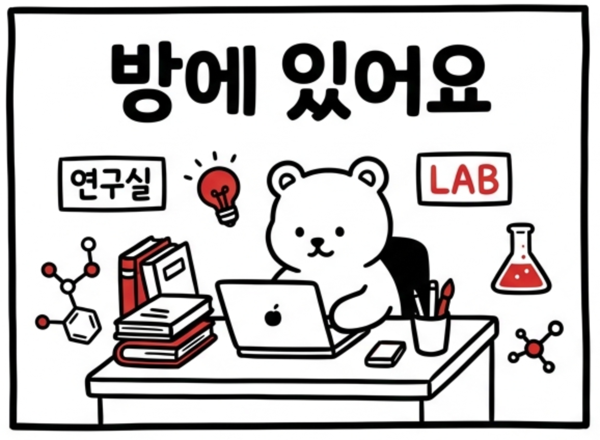 | 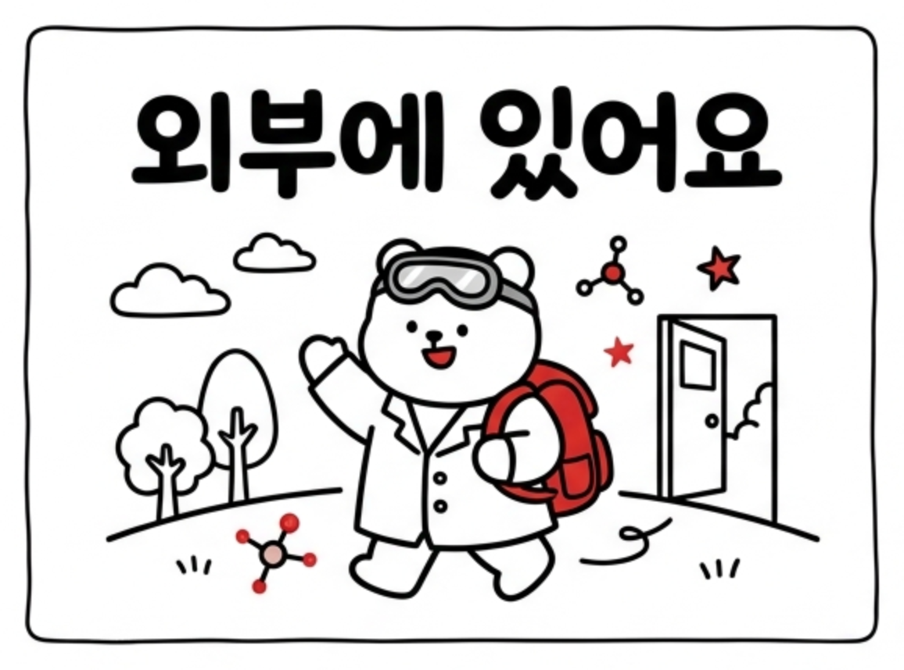 | 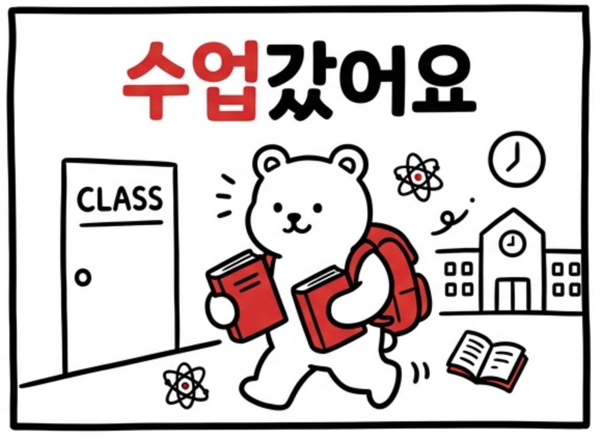 | 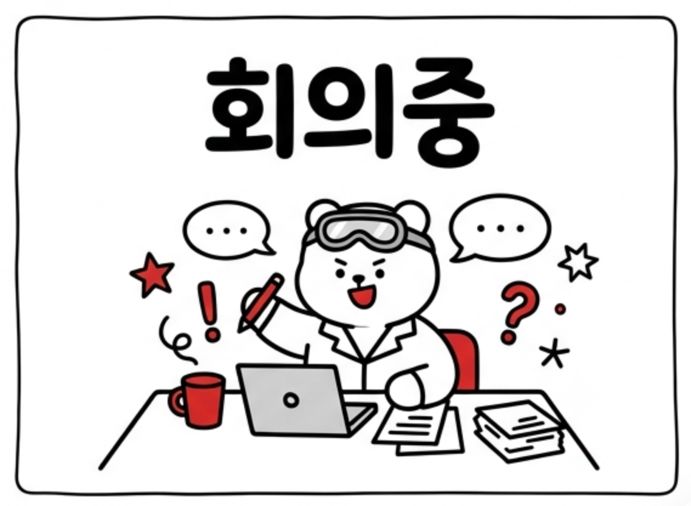 | 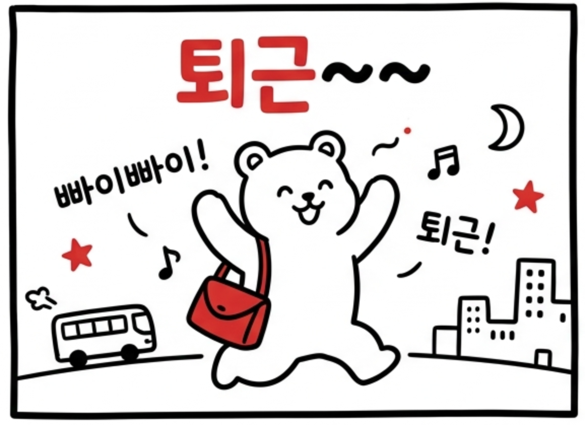 |
| **운동갔어요** | **밥먹고있어요** | **아파요** | **세미나중** | **배터리 부족 경고** |
| 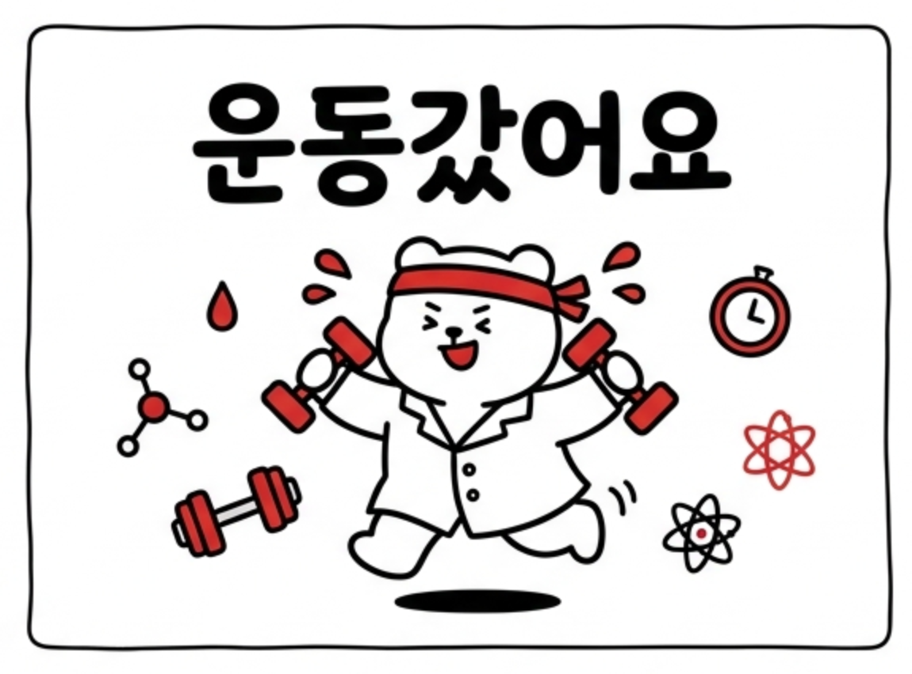 |  | 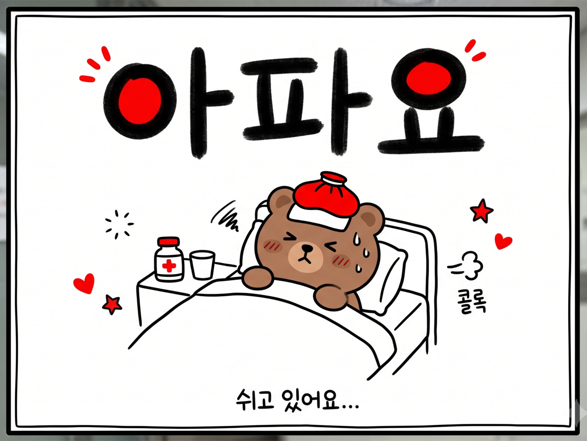 |  | 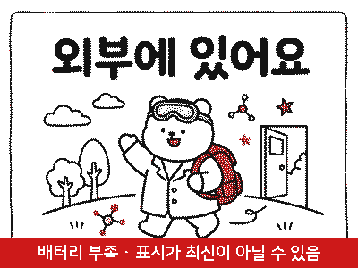 |
