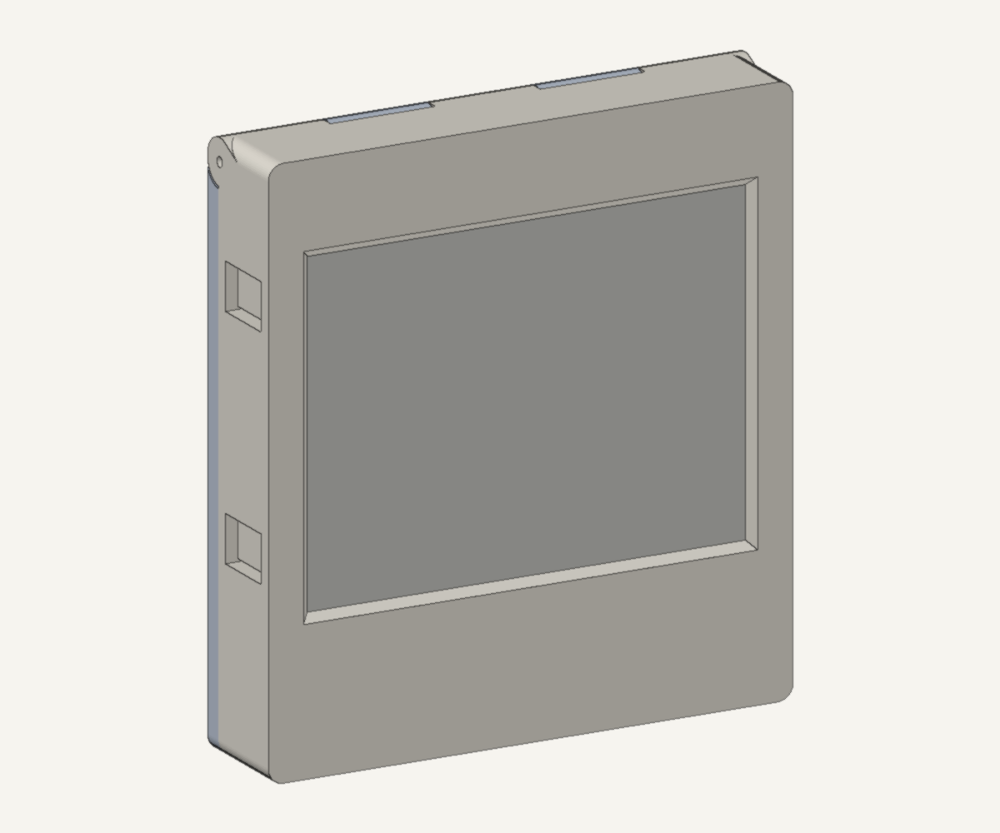
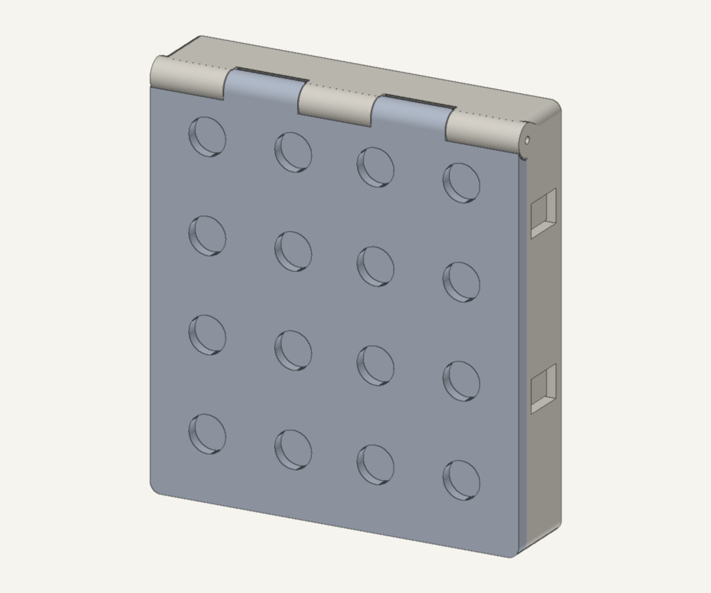
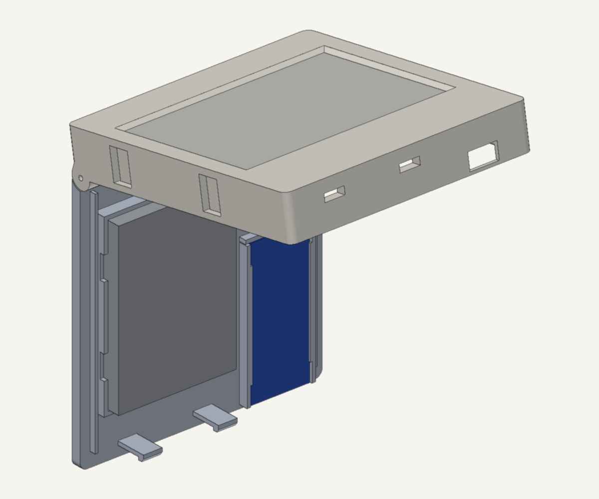
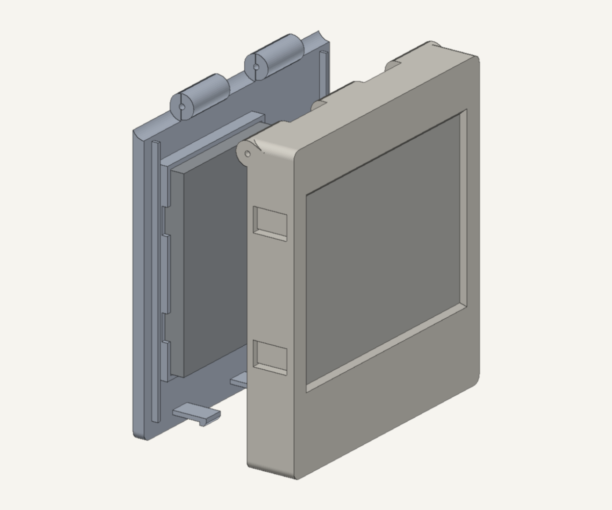
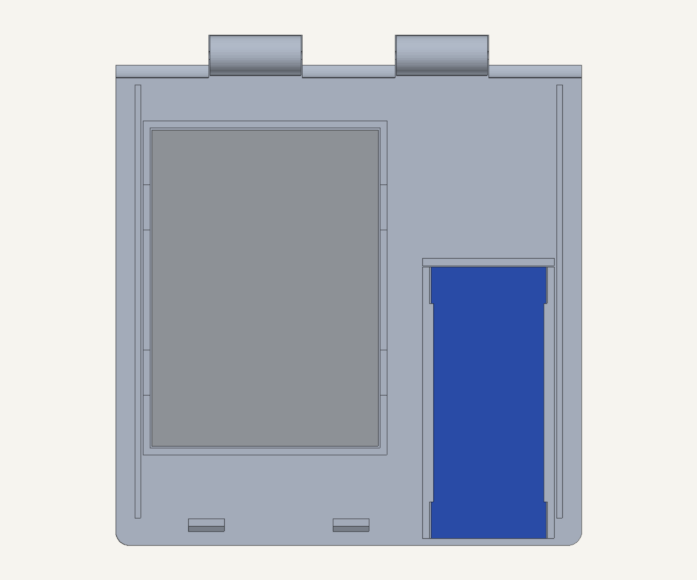
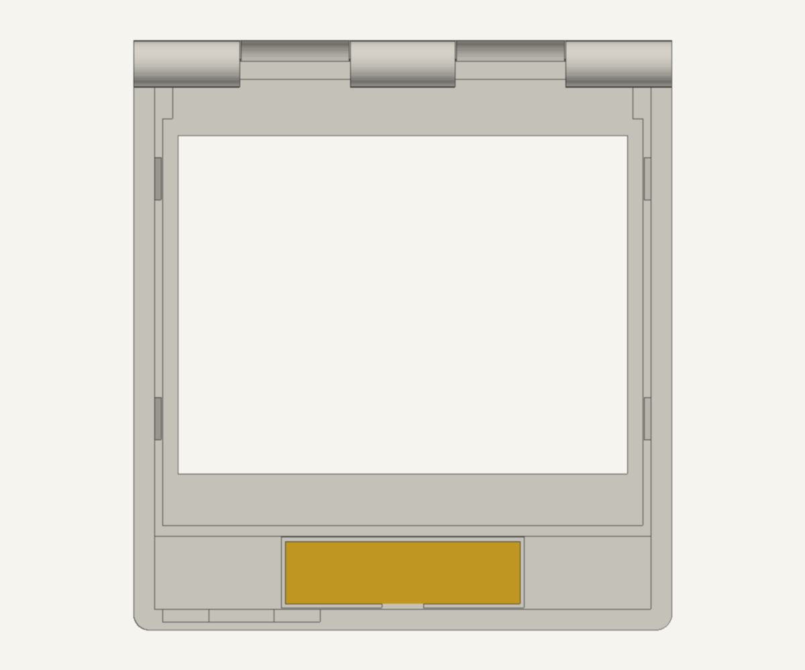

# 케이스 2.0 (설계 중)

1.0의 문제를 고치는 케이스입니다.
- 철문 때문에 약해지는 WiFi
- 앞뒤 판이 벌어지는 문제
- 나사가 없어 글루건으로 붙인 고정
- 자석 6개로는 약한 부착

| 앞 | 뒤(자석 16개) |
|---|---|
|  |  |
| **열린 상태(위쪽 힌지)** | **분해도** |
|  |  |
| **뒷판 안쪽(배터리·보드)** | **앞판 안쪽(뒤에서 본 모습, 좌우 반전)** |
|  |  |

## 구성

- **외형**: 103 × 113 × 22.45mm. 1.0(103 × 99 × 14.75)보다 아래로 14mm, 뒤로 7.7mm 커졌습니다.
- **전면부**: 표시 창(89.2 × 68mm, 바깥 45° 모따기)과 기판 받침 턱은 1.0에서 실제로 출력해 장착이 확인된 치수 그대로입니다.
- **e-paper 고정**: 좌우 옆벽에 스냅 탭이 4개 있습니다. 기판을 뒤에서 밀어 넣으면 걸립니다. 뺄 때는 옆면의 오목한 곳을 바깥에서 눌러 탭을 벌립니다.
- **힌지(위쪽)**: 앞판과 뒷판이 번갈아 맞물리는 5마디 힌지입니다.
  - 핀은 1.75mm 필라멘트 토막(또는 펼친 클립)을 옆 구멍(Ø2.0)으로 끼웁니다. 나사가 필요 없습니다.
  - 힌지는 외곽선 안에 숨겨져 있어 뒷면이 문에 평평하게 붙습니다.
  - 30°, 60°, 100°, 120°로 열어 앞판과 뒷판이 부딪히지 않는 것을 계산으로 확인했습니다.
- **잠금(아래쪽)**:
  - 뒷판에서 솟은 스냅 훅 2개가 앞판 바닥벽 구멍에 걸립니다. 걸림 깊이는 0.9mm, 외팔보 길이는 13mm라 PLA 변형률이 약 1.7%입니다.
  - 열 때는 바닥 구멍으로 핀이나 손톱을 넣어 훅을 안쪽으로 누릅니다.
- **부품 배치**: 보드와 배터리는 **뒷판(문에 붙는 쪽)**에 있습니다. 열면 무거운 쪽은 문에 붙어 있고, 가벼운 앞판만 위로 젖혀집니다.
- **자석**: Ø10 × 3mm 포켓 16개(4 × 4)가 바깥면에 있습니다. 압입한 뒤 순간접착제로 고정합니다.
- **안테나 칸**:
  - 표시부 아래 14mm에 FPC 안테나 자리가 있습니다. 동봉된 2.4GHz FPC 안테나를 앞판 안쪽면 가이드에 붙입니다.
  - 철판에서 약 21mm 떨어지고, e-paper 기판(접지면) 뒤를 피하는 위치입니다.
- **보드**: FireBeetle 2 ESP32-C5-U(25.4 × 60mm)용 레일에 끼웁니다.
  - USB-C가 **아래쪽**을 향해서 케이블이 아래로 늘어집니다.
  - USB 쪽 바닥벽은 1.6mm만 남겨 플러그가 끝까지 들어가게 했습니다.
- **배터리**: 뒷판의 울타리 안에 둡니다. 모서리 트임으로 벨크로나 케이블타이를 통과시킬 수 있고, 양면 폼테이프를 함께 쓰면 좋습니다.

## 출력

| 파일 | 출력 방향 | 비고 |
|---|---|---|
| [`stl/front_v2.stl`](stl/front_v2.stl) | 앞면이 베드 | 힌지 마디 밑에 45° 받침이 있어 서포트 불필요 |
| [`stl/cover_v2.stl`](stl/cover_v2.stl) | 바깥면(자석)이 베드 | 훅·레일·울타리가 위로 솟음. 서포트 불필요 |

- PLA, 노즐 0.4mm, 레이어 0.2mm, 벽 3줄 이상을 권장합니다. 스냅 훅과 탭은 휘어야 해서 인필보다 벽 수가 중요합니다.
- **조립 순서**:
  1. 자석을 압입합니다(극성을 한 방향으로).
  2. 뒷판에 배터리를 붙이고 보드를 레일에 끼웁니다.
  3. e-paper를 앞판에 딸깍 넣고, 안테나를 칸에 붙이고, U.FL을 연결합니다.
  4. 힌지 핀을 끼우고 닫습니다.

## 출력 전에 실측해서 고칠 값 (`[MEASURE]`)

`roomdisplay_case_v2.scad` 맨 위의 변수만 고치면 됩니다.

| 변수 | 지금 값 | 확인할 것 |
|---|---|---|
| `bat_w`, `bat_h`, `bat_t` | 50 × 70 × 10 | **3500mAh 배터리 실측값**. 두께가 10을 넘으면 `comp_d`도 늘림 |
| `ant_w`, `ant_h` | 45 × 12 | 보드에 동봉된 FPC 안테나 크기 |
| `brd_*`, `usb_*` | 25.4 × 60, USB 중심은 보드 윗면 위 1.6 | 실제 보드의 USB-C 위치와 받침 높이 |
| `mag_d`, `mag_t` | 10 × 3 | 가진 자석 |

## 검사와 렌더

```bash
tools/scad.sh print_front stl/front_v2.stl     # 출력용 STL (OpenSCAD는 원격 Docker에서 실행)
tools/scad.sh print_cover stl/cover_v2.stl
tools/scad.sh check_overlap /tmp/x.stl         # 닫힌 상태 겹침: 접촉면만 나오면 정상
tools/scad.sh check_open /tmp/x.stl            # 열린 상태 간섭: "결과 없음"이면 정상
python3 tools/render_stl.py scene.json out.png # 미리보기 렌더(numpy + Pillow)
```

- Homebrew의 OpenSCAD cask는 macOS Gatekeeper 문제로 막혀 있어서 공식 Docker 이미지를 씁니다.
- 그 이미지의 PNG 출력은 헤드리스 환경에서 멈춰서, 미리보기는 `render_stl.py`로 그립니다.
